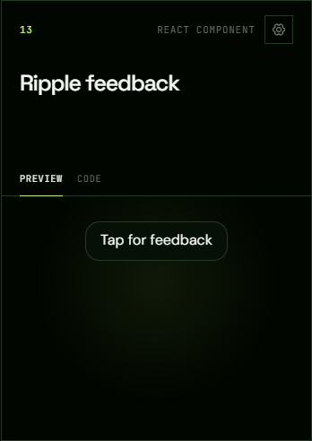

# V1Components

A React component library by Victor Marques with 83 interactive experiments and copyable source.

[Open the Lab](https://victormarques.dev/lab) · [Browse the catalog](CATALOG.md) · [Install motion skills](SKILLS.md)

## Motion skills

Use [V1Components Motion](skills/v1c-motion/SKILL.md) to implement interactions and [V1Components Motion Review](skills/v1c-motion-review/SKILL.md) to check them. Both work with Codex and Claude Code. See the [installation guide](SKILLS.md).

## Component previews

[Ripple Feedback](docs/ripple-feedback.md) · [Star Rating](docs/star-rating.md) · [Accordion Spring](docs/accordion-spring.md)

The [full catalog](CATALOG.md) keeps the Lab order and groups components by interaction. Every entry includes documentation, source, and a motion recording.

## Use a component

1. Open its **Source** link for the default implementation, or use **Settings → Code → Copy code** in the Lab for a configured version.
2. Install React and the external packages at the top of the bundle. Save each named file at the path in its header.
3. Import the component or render the example. Keep the bundled styles alongside the code.

To unpack a bundle into its files with Node.js, run `node scripts/unpack.mjs segmented`. An optional second argument sets the output directory.

The portfolio serves the current configured exports. This repository is the versioned source and preview snapshot. See [release maintenance](CONTRIBUTING.md#maintain-a-release) for the sync steps.

## Project

[Motion guidelines](MOTION.md) · [Contributing](CONTRIBUTING.md) · [Credits](THIRD_PARTY_NOTICES.md)

The source is available under the [MIT License](LICENSE). Icons are provided by [Phosphor Icons](https://phosphoricons.com/) under their own [MIT license](licenses/phosphor-react.txt).
