# V1Components

A React component library by Victor Marques. The approved catalog follows the same order as the [live Lab](https://victormarques.dev/lab).

[Motion guidelines](MOTION.md) · [Contributing](CONTRIBUTING.md) · [Credits](THIRD_PARTY_NOTICES.md)

## Use a component

1. Open its **Source** link for the default implementation, or use **Settings → Code → Copy code** in the Lab for a configured version.
2. Install React and the external packages at the top of the bundle. Save each named file at the path in its header.
3. Import the component or render the example. Keep the bundled styles alongside the code.

To unpack a bundle into its files with Node.js, run `node scripts/unpack.mjs segmented`. An optional second argument sets the output directory.

The portfolio serves the current configured exports. This repository is the versioned source and preview snapshot. See [release maintenance](CONTRIBUTING.md#maintain-a-release) for the sync steps.

## Catalog

| # | Component | Preview |
| ---: | --- | --- |
| 01 | [Segmented](docs/segmented.md) · [Source](snippets/segmented.txt) · [Video](media/segmented.webm) | 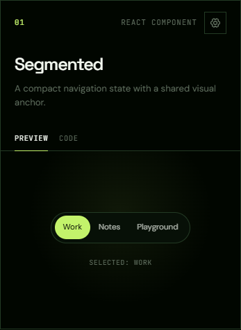 |
| 02 | [Spring modal](docs/spring-modal.md) · [Source](snippets/spring-modal.txt) | 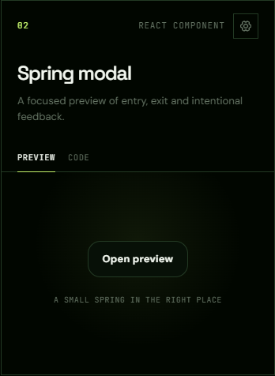 |
| 03 | [Elastic loading](docs/elastic-loading.md) · [Source](snippets/elastic-loading.txt) | 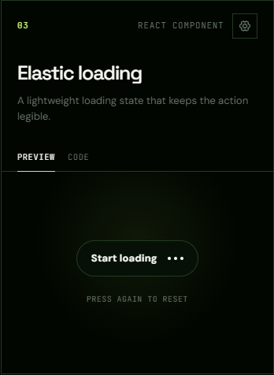 |
| 04 | [Blast Impact](docs/blast-impact.md) · [Source](snippets/blast-impact.txt) | 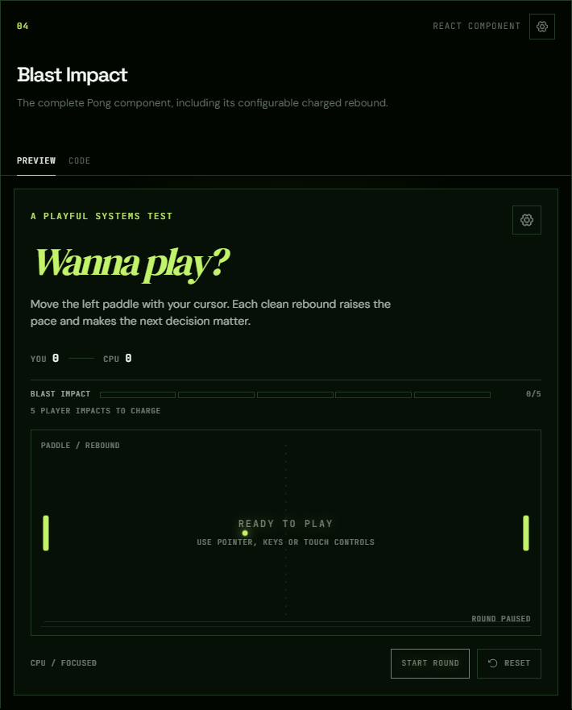 |
| 05 | [Hover glow container](docs/hover-glow-container.md) · [Source](snippets/hover-glow-container.txt) | 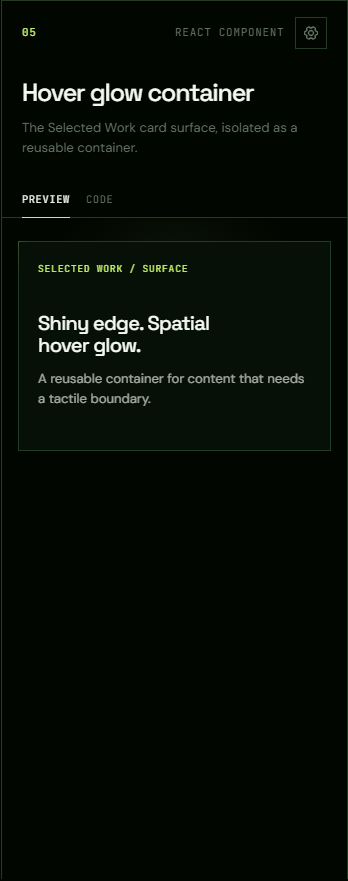 |
| 06 | [Button](docs/button.md) · [Source](snippets/button.txt) | 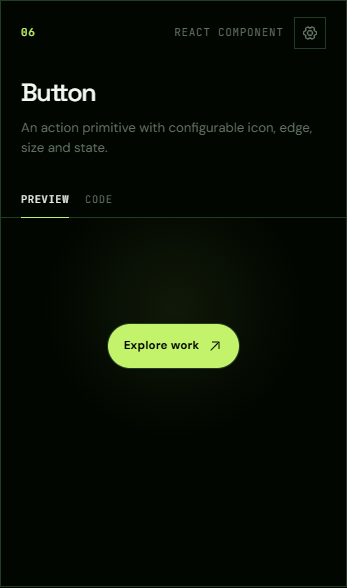 |
| 07 | [Text input](docs/text-input.md) · [Source](snippets/text-input.txt) | 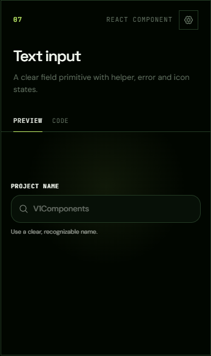 |
| 08 | [Dropdown](docs/dropdown.md) · [Source](snippets/dropdown.txt) | 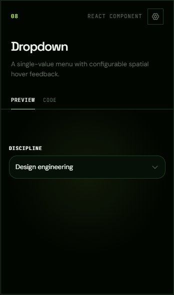 |
| 09 | [Selector](docs/selector.md) · [Source](snippets/selector.txt) | 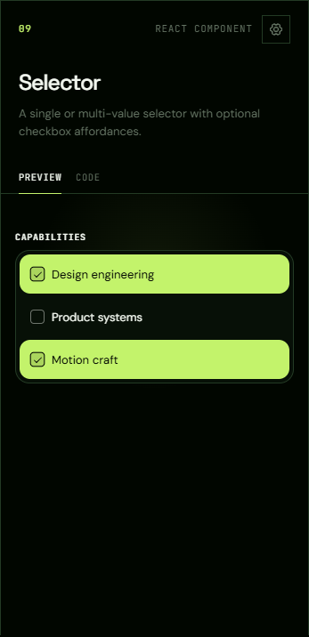 |
| 10 | [Color picker](docs/color-picker.md) · [Source](snippets/color-picker.txt) | 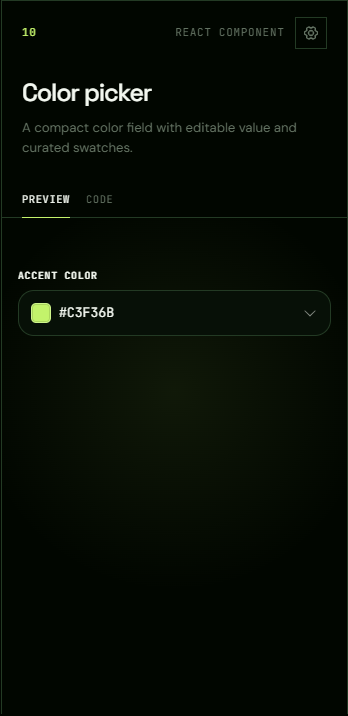 |
| 11 | [Date picker](docs/date-picker.md) · [Source](snippets/date-picker.txt) | 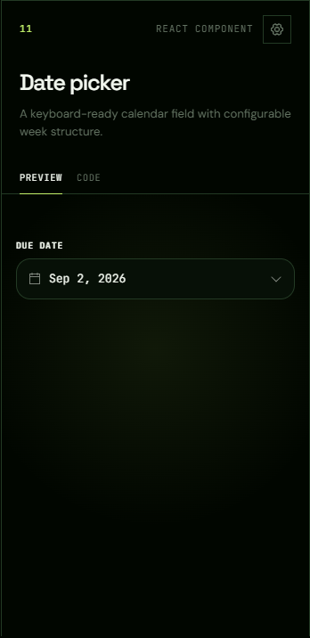 |
| 12 | [Magnetic button](docs/magnetic-button.md) · [Source](snippets/magnetic-button.txt) | 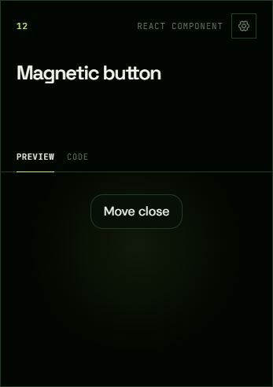 |
| 13 | [Ripple feedback](docs/ripple-feedback.md) · [Source](snippets/ripple-feedback.txt) |  |
| 14 | [Like burst](docs/like-burst.md) · [Source](snippets/like-burst.txt) · [Video](media/like-burst.webm) | 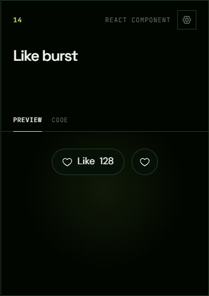 |
| 15 | [Push button](docs/push-button.md) · [Source](snippets/push-button.txt) | 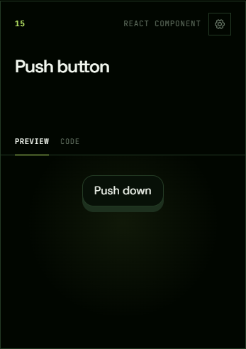 |
| 16 | [Copy button](docs/copy-button.md) · [Source](snippets/copy-button.txt) | 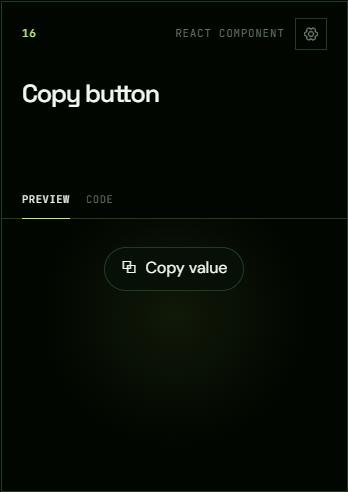 |
| 17 | [Squish button](docs/squish-button.md) · [Source](snippets/squish-button.txt) | 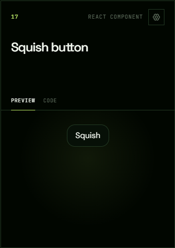 |
| 18 | [Keycap press](docs/keycap-press.md) · [Source](snippets/keycap-press.txt) | 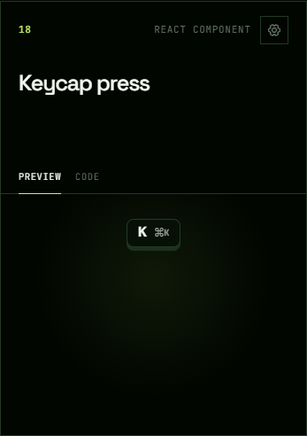 |
| 19 | [Liquid glass press](docs/liquid-glass-press.md) · [Source](snippets/liquid-glass-press.txt) | 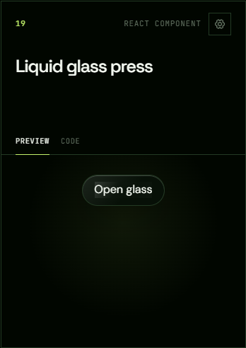 |
| 20 | [Badge counter](docs/badge-counter.md) · [Source](snippets/badge-counter.txt) | 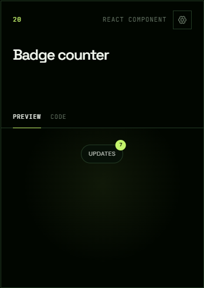 |
| 21 | [Bookmark toggle](docs/bookmark-toggle.md) · [Source](snippets/bookmark-toggle.txt) | 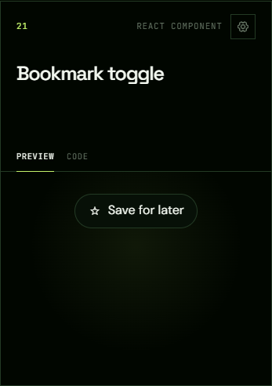 |
| 22 | [Star rating](docs/star-rating.md) · [Source](snippets/star-rating.txt) · [Video](media/star-rating.webm) | 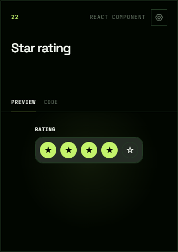 |
| 23 | [Floating label](docs/floating-label.md) · [Source](snippets/floating-label.txt) | 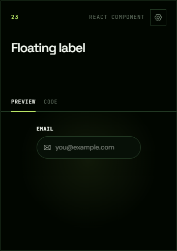 |
| 24 | [Quantity stepper](docs/quantity-stepper.md) · [Source](snippets/quantity-stepper.txt) | 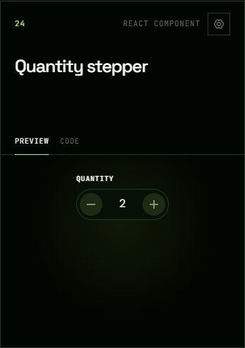 |
| 25 | [Choice chips](docs/choice-chips.md) · [Source](snippets/choice-chips.txt) | 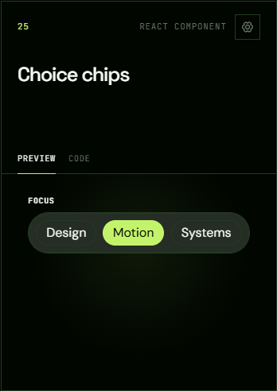 |
| 26 | [Pin input](docs/pin-input.md) · [Source](snippets/pin-input.txt) | 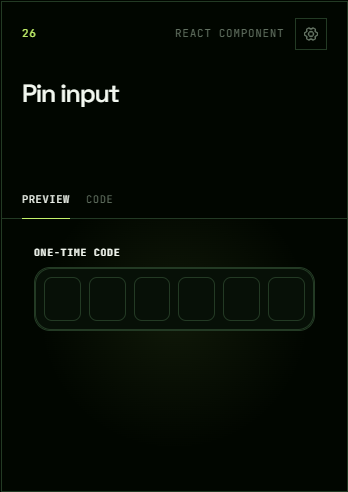 |
| 27 | [Password meter](docs/password-meter.md) · [Source](snippets/password-meter.txt) | 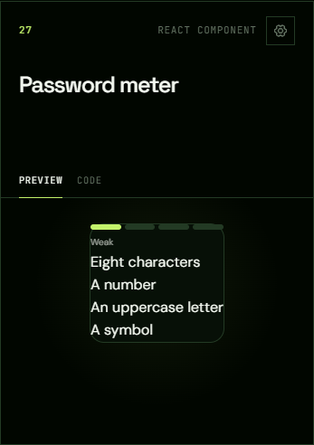 |
| 28 | [Expanding search](docs/expanding-search.md) · [Source](snippets/expanding-search.txt) | 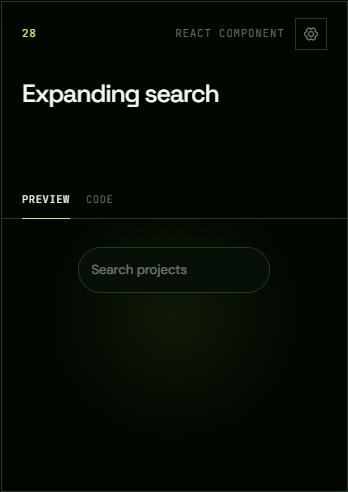 |
| 29 | [Toggle pills](docs/toggle-pills.md) · [Source](snippets/toggle-pills.txt) | 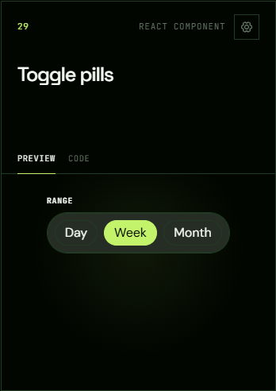 |
| 30 | [Swatch picker](docs/swatch-picker.md) · [Source](snippets/swatch-picker.txt) | 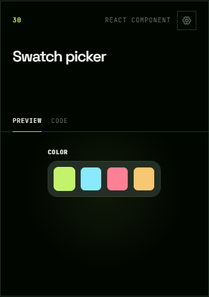 |
| 31 | [Tag input](docs/tag-input.md) · [Source](snippets/tag-input.txt) | 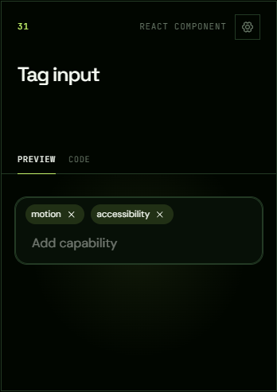 |
| 32 | [Switch spring](docs/switch-spring.md) · [Source](snippets/switch-spring.txt) | 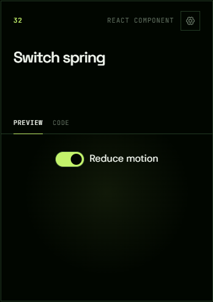 |
| 33 | [Checkbox draw](docs/checkbox-draw.md) · [Source](snippets/checkbox-draw.txt) | 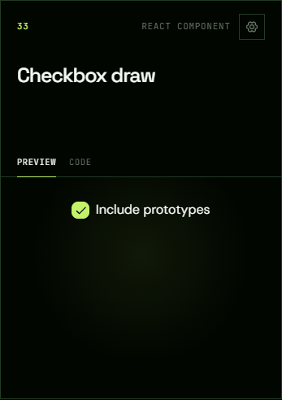 |
| 34 | [Card resize](docs/card-resize.md) · [Source](snippets/card-resize.txt) | 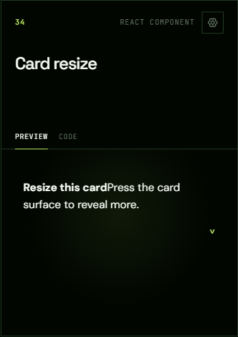 |
| 35 | [Tab pill glide](docs/tab-pill-glide.md) · [Source](snippets/tab-pill-glide.txt) · [Video](media/tab-pill-glide.webm) | 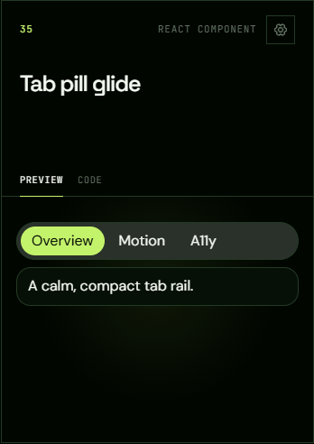 |
| 36 | [Accordion spring](docs/accordion-spring.md) · [Source](snippets/accordion-spring.txt) · [Video](media/accordion-spring.webm) | 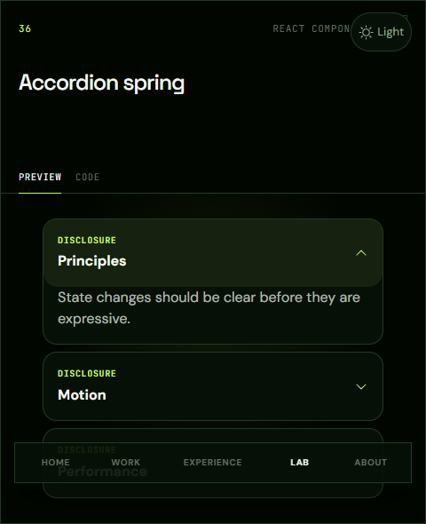 |
| 37 | [Speed dial fab](docs/speed-dial-fab.md) · [Source](snippets/speed-dial-fab.txt) · [Video](media/speed-dial-fab.webm) | 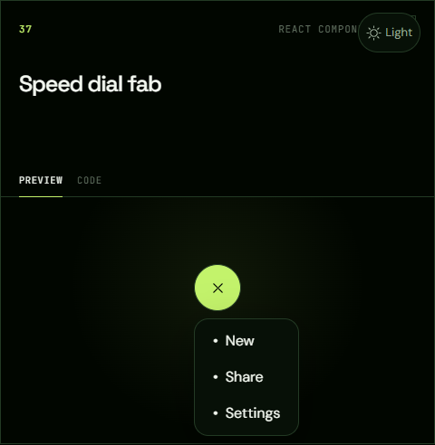 |
| 38 | [Orbital action menu](docs/orbital-action-menu.md) · [Source](snippets/orbital-action-menu.txt) | 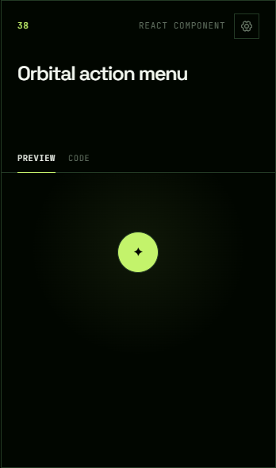 |
| 39 | [Contextual dock](docs/contextual-dock.md) · [Source](snippets/contextual-dock.txt) | 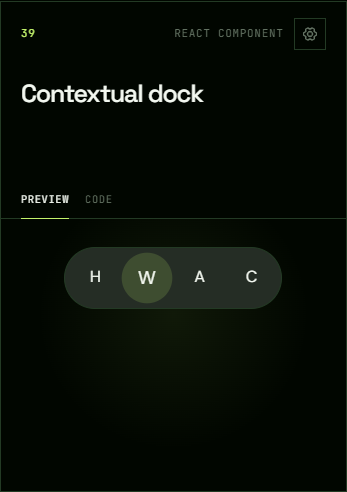 |
| 40 | [Hover intent gate](docs/hover-intent-gate.md) · [Source](snippets/hover-intent-gate.txt) | 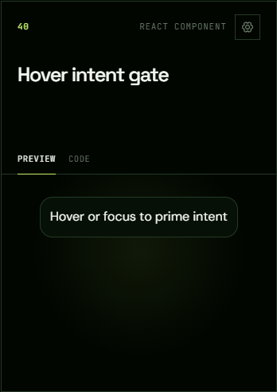 |
| 41 | [Bento expand](docs/bento-expand.md) · [Source](snippets/bento-expand.txt) · [Video](media/bento-expand.webm) | 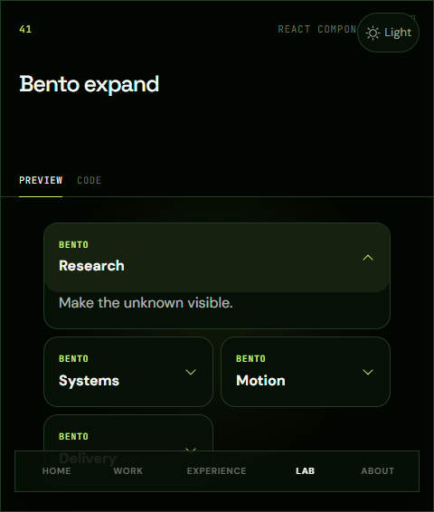 |
| 42 | [Snap rail](docs/snap-rail.md) · [Source](snippets/snap-rail.txt) | 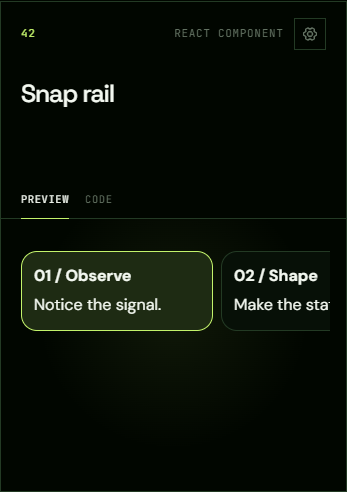 |
| 43 | [Command palette bloom](docs/command-palette-bloom.md) · [Source](snippets/command-palette-bloom.txt) | 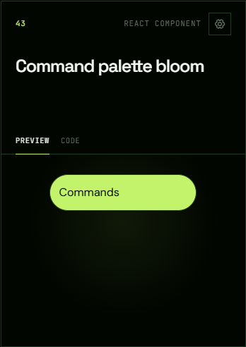 |
| 44 | [Focus relay](docs/focus-relay.md) · [Source](snippets/focus-relay.txt) | 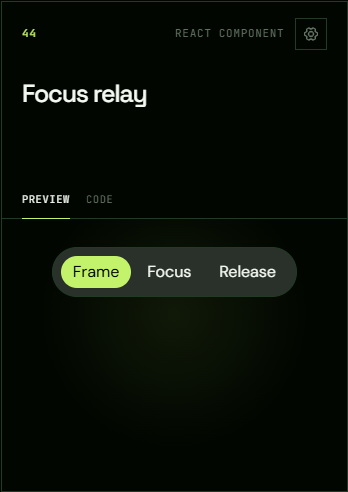 |
| 45 | [Delayed tooltip](docs/delayed-tooltip.md) · [Source](snippets/delayed-tooltip.txt) | 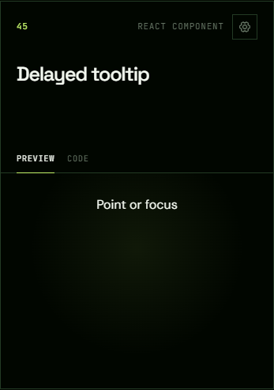 |
| 46 | [Hold to confirm](docs/hold-to-confirm.md) · [Source](snippets/hold-to-confirm.txt) · [Video](media/hold-to-confirm.webm) | 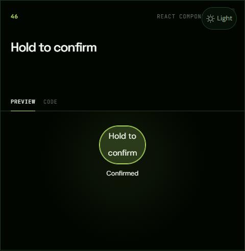 |
| 47 | [Rubber band slider](docs/rubber-band-slider.md) · [Source](snippets/rubber-band-slider.txt) | 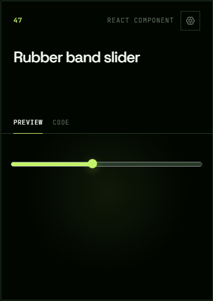 |
| 48 | [Rotary knob](docs/rotary-knob.md) · [Source](snippets/rotary-knob.txt) | 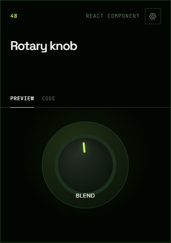 |
| 49 | [Value scrubber](docs/value-scrubber.md) · [Source](snippets/value-scrubber.txt) | 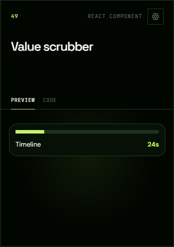 |
| 50 | [Slide to unlock](docs/slide-to-unlock.md) · [Source](snippets/slide-to-unlock.txt) | 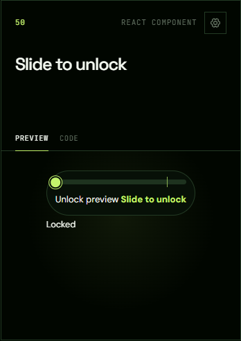 |
| 51 | [Inertial dial](docs/inertial-dial.md) · [Source](snippets/inertial-dial.txt) | 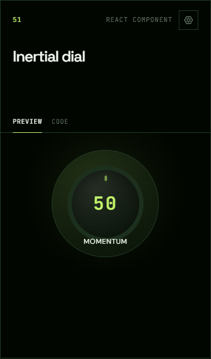 |
| 52 | [Gesture chord](docs/gesture-chord.md) · [Source](snippets/gesture-chord.txt) |  |
| 53 | [Kinetic xy pad](docs/kinetic-xy-pad.md) · [Source](snippets/kinetic-xy-pad.txt) |  |
| 54 | [Momentum picker](docs/momentum-picker.md) · [Source](snippets/momentum-picker.txt) |  |
| 55 | [Filmstrip scrubber](docs/filmstrip-scrubber.md) · [Source](snippets/filmstrip-scrubber.txt) |  |
| 56 | [Hold to talk](docs/hold-to-talk.md) · [Source](snippets/hold-to-talk.txt) |  |
| 57 | [Drag to dismiss](docs/drag-to-dismiss.md) · [Source](snippets/drag-to-dismiss.txt) |  |
| 58 | [Swipe to reveal](docs/swipe-to-reveal.md) · [Source](snippets/swipe-to-reveal.txt) |  |
| 59 | [Reorderable list](docs/reorderable-list.md) · [Source](snippets/reorderable-list.txt) |  |
| 60 | [Elastic lasso](docs/elastic-lasso.md) · [Source](snippets/elastic-lasso.txt) |  |
| 61 | [Drag stack collect](docs/drag-stack-collect.md) · [Source](snippets/drag-stack-collect.txt) |  |
| 62 | [Lattice snap](docs/lattice-snap.md) · [Source](snippets/lattice-snap.txt) |  |
| 63 | [Before after](docs/before-after.md) · [Source](snippets/before-after.txt) |  |
| 64 | [Toast overshoot](docs/toast-overshoot.md) · [Source](snippets/toast-overshoot.txt) |  |
| 65 | [Prompt composer](docs/prompt-composer.md) · [Source](snippets/prompt-composer.txt) |  |
| 66 | [Status pill](docs/status-pill.md) · [Source](snippets/status-pill.txt) |  |
| 67 | [Notification slide in](docs/notification-slide-in.md) · [Source](snippets/notification-slide-in.txt) |  |
| 68 | [Undo snackbar](docs/undo-snackbar.md) · [Source](snippets/undo-snackbar.txt) |  |
| 69 | [Submit states](docs/submit-states.md) · [Source](snippets/submit-states.txt) |  |
| 70 | [Toast stack](docs/toast-stack.md) · [Source](snippets/toast-stack.txt) |  |
| 71 | [Elastic progress](docs/elastic-progress.md) · [Source](snippets/elastic-progress.txt) |  |
| 72 | [Segment loader](docs/segment-loader.md) · [Source](snippets/segment-loader.txt) |  |
| 73 | [Orbit spinner](docs/orbit-spinner.md) · [Source](snippets/orbit-spinner.txt) |  |
| 74 | [Progress ring](docs/progress-ring.md) · [Source](snippets/progress-ring.txt) |  |
| 75 | [Step progress](docs/step-progress.md) · [Source](snippets/step-progress.txt) |  |
| 76 | [Countdown ring](docs/countdown-ring.md) · [Source](snippets/countdown-ring.txt) |  |
| 77 | [Skeleton to content](docs/skeleton-to-content.md) · [Source](snippets/skeleton-to-content.txt) |  |
| 78 | [Indeterminate bar](docs/indeterminate-bar.md) · [Source](snippets/indeterminate-bar.txt) |  |
| 79 | [Shimmer skeleton](docs/shimmer-skeleton.md) · [Source](snippets/shimmer-skeleton.txt) |  |
| 80 | [Typing indicator](docs/typing-indicator.md) · [Source](snippets/typing-indicator.txt) |  |
| 81 | [Battery charge](docs/battery-charge.md) · [Source](snippets/battery-charge.txt) |  |
| 82 | [Signal bars](docs/signal-bars.md) · [Source](snippets/signal-bars.txt) |  |
| 83 | [Wave loader](docs/wave-loader.md) · [Source](snippets/wave-loader.txt) · [Video](media/wave-loader.webm) |  |

The source is available under the [MIT License](LICENSE). Icons are provided by [Phosphor Icons](https://phosphoricons.com/) under their own [MIT license](licenses/phosphor-react.txt).
